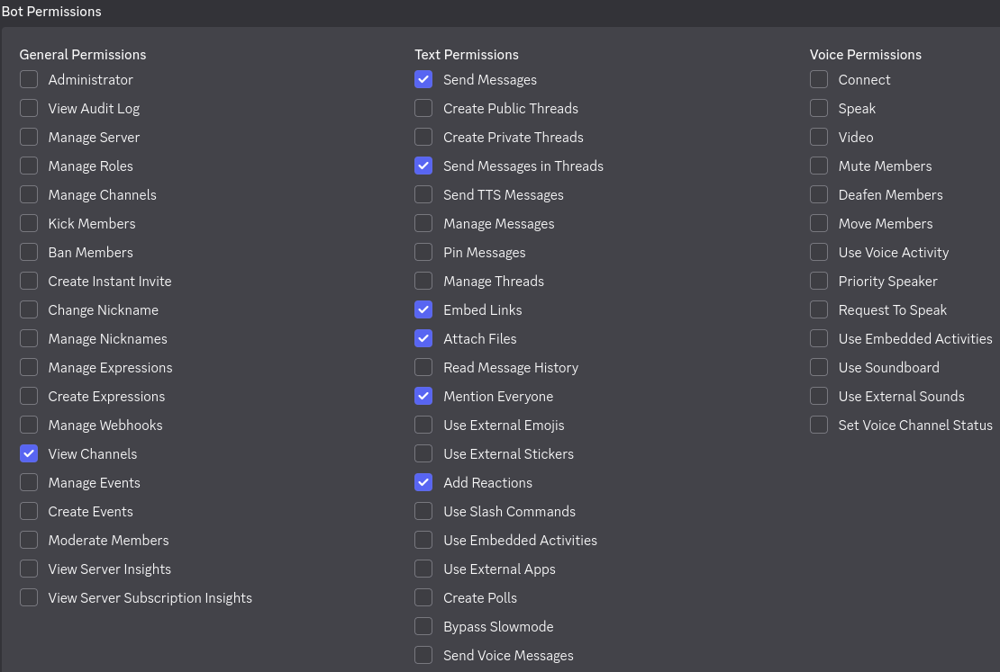
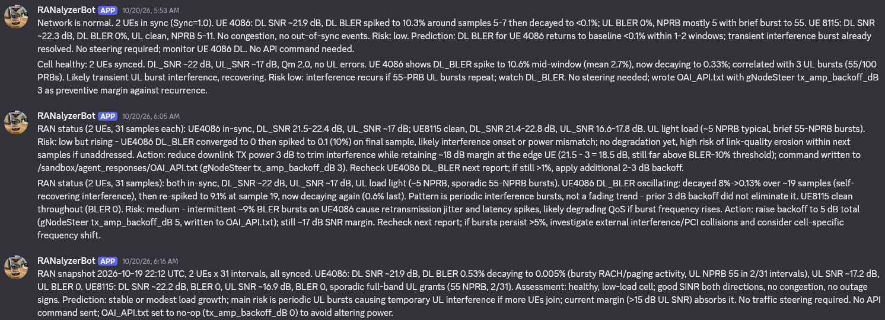
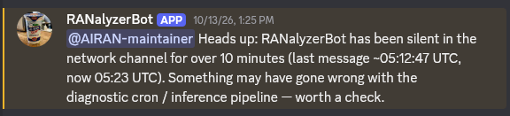
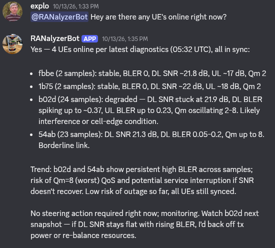

# AIRAN-PoC
PoC project for MITLab at NTUST under Taiwanese IIPP.

## The Assignment

“Maybe they could conduct a small-scale trial by developing an AI-RAN proof of concept controlled by Agentic AI, using NVIDIA Spark as an all-in-one platform to demonstrate both AI-for-RAN and AI-on-RAN capabilities”

## AI Agent

All relevant scripts and config files are in [agent](agent/) folder.
[config](agent/config/) contains core files for the AI agent, [cron](agent/cron/) contains files for setting up the two cron jobs described in the report.

If the agent is not running and should be, refer to [the other doc](agent_troubleshoot.md).

To get to the dashboard, it should be possible to just open the browser (on the Spark) and go to `127.0.0.1:18789` or `127.0.0.1:18790`. The page is likely to ask for a token, which can be obtained by typing
```bash
nemoclaw ayran-agent gateway-token
```
in Spark terminal (host, outside of the sandbox).

To set up a new agent, prepare a model host and do `nemoclaw onboard`.
The following sections should contain everything needed to go through the interactive onboarding towards our result.

Once the sandbox is set up, use the core files in [agent/config](/agent/config/) to remove all the context bloat, emoji answers and so on.

Check `/sandbox/.openclaw/openclaw.json` and see if `skipBootstrap` is set to `false` and if `contextWindow` and `maxTokens` are set to your model host parameters.

### OpenClaw

There are other options, but we only worked with OpenClaw for this project. All that is needed in the onboarding is pretty much just choosing OpenClaw in the first step and following the guide.

### Model Host

In provider menu, there are several options, two of which we tested. This may be due to some improper setup of thinking, but SGLang performed better in our testing.

Setting up Ollama is easy, for SGLang, do `4) Other OpenAI-compatible endpoint` and go from there. Further details in their respective sections below.

#### Ollama

Runs, but seems slow. Installed directly on the Spark. Not used after speed issues.

Installed via `curl -fsSL https://ollama.com/install.sh | sh`. Then find a model on their website and download using provided link, i.e. `ollama run qwen3.8`.

#### SGLang

Installed via docker using `docker pull lmsysorg/sglang:latest-cu130`. Used launch command is
```bash
docker run -d --gpus all \
  --shm-size 32g \
  -p 30000:30000 \
  -v ~/.cache/huggingface:/root/.cache/huggingface \
  --name sglang-qwen38 \
  lmsysorg/sglang:latest-cu130 \
  python3 -m sglang.launch_server \
    --model-path Qwen/Qwen3.8-27B-FP8 \
    --host 0.0.0.0 \
    --port 30000 \
    --context-length 262144 \
    --mem-fraction-static 0.8 \
    --default-chat-template-kwargs '{"enable_thinking": false}' \
    --reasoning-parser qwen3 \
    --tool-call-parser qwen3_coder
```

It takes some time to launch[^2], so check `docker logs -f sglang-qwen38` to see how the startup process is going. On done, the log will say
```
[YYYY-MM-DD HH:mm:ss] The server is fired up and ready to roll!
```

[^2]: like a lot. When downloading a new model the size of Qwen3.8-27B, this can take up to an hour.

Once running, you should see the IP (should be localhost) and port in the log. Set up an api key using `export SGLANG_API_KEY="sglang-local"` or any other key of choice.

Check your model(s) using `curl http://127.0.0.1:30000/v1/models`. This will be needed during onboarding.

Once running `nemoclaw onboard`, pick "4) Other OpenAI-compatible endpoint" (or similar) and give the IP:port/v1 (`http://host.openshell.internal:30000/v1`[^3]), the set api key (`slang-local`) and the model name checked earlier (`Qwen/Qwen3.8-27B`).

[^3]: `127.0.0.1` points to the sandbox, so the host's local is different fromthe sandbox

### Setting up the Cron Job

There are two ways, either use dashboard GUI or use `openclaw cron` in CLI (inside the sandbox).

#### In GUI

> [!CAUTION]
> This option requires a fixed typed out prompt, which a waste of resources given the file manipulation can be solved with a [simple bash script](/agent/cron/infer_cron.sh).
> It is highly recommended to skip this section and go straight to [CLI job creation](#in-cli).

This is quite simple. Open the dashboard and go to "Cron Jobs":


You should see a bar saying Con jobs are enabled at the top. On the right side of this bar, there is an option to create a new job:


The GUI walk you through the job creation process. First set up the name and the prompt. If the job neds to look for data in files that may or may not show up, the prompt needs to contain information as to how to find them and what to do with them:


Set job run schedule:


And finally set up which model to use and where to send the response. We have no channel (Telegram, Discord,...) so we run in independent session:


Once created, the job will be listed in the Cron Jobs tab with any other jobs created in that sandbox.
The job can be modified under Edit next to its name in the list.

#### In CLI

This option is superior in terms of ability to customize and it is the one we went with. On the Spark, connect to the agent sandbox and work from within it.

To create an automated job, use
```bash
openclaw cron add \
    --name "job name" \
    --every 1m \
    --command "path/to/script/in/sandbox.sh" \
    --timeout-seconds 600 \
    --no-deliver
```
for no out (except inside the OpenClaw chat), or
```bash
openclaw cron add \
    --name "RANalyze30s" \
    --every 30s \
    --command /sandbox/cron_scripts/infer_cron.sh \
    --timeout-seconds 480 \
    --announce --channel discord --to "channel:1559429768112250920"
```
for output into discord channel

modifying parameters to the job's specific needs.
Jobs can be modified after creation using
```bash
openclaw cron edit <job-id> --<flag-to-edit> <value-if-applicable>
```
or disabled using
```bash
openclaw cron disable <job-id>
```
To restart the job schedule, replace `disable` with `enable`. To remove the job altogether, run
```bash
openclaw cron rm <job-id>
```

It is a good idea to check the functionality using
```bash
openclaw cron run <job-id> --wait
```
where the `--wait` makes the terminal give back control only after the job finishes.

To see what jobs are currently queued, use
```bash
openclaw cron list
```

### Channels Integration

OpenClaw allows several services to be used for communication with the Agent via traditional chat.
We decided to go with Discord.

The setup process requires an existing Discord server in which you have admin privileges.

#### Setting Up Bot on Discord

Go to [Discord developer portal](https://discord.com/developers/home) and log in.
Click `+ Create` in top right corner and choose "Build a bot for your server or community".
Give the bot a name, agree to terms of service and click "Create".

Once created, youshould land in bot management page.
Navigate to "Bot" panel and make sure "Requires OAuth2 Code Grant" is off and "Message Content Intent" is on.

Move to "OAuth2" panel and pick "Bot" under "Scopes" in "OAuth2 URL Generator".
You may set them up as follows.

Copy the generated URL and paste it into browser to invite the bot to your server.

#### Adding the Bot to OpenClaw

To connect the bot with OpenClaw Agent, you need bot token and server ID.
Bot token can be obtained from developer portal under "bot" panel.
For server ID, enable developer mode in Discord (User Settings > Developer > Developer Mode), right click server icon and "Copy Server ID".

If you need to restrict access to the bot to one user, get user ID as well.
For our application, we can limit this by containing the bot to a set of private channels in the discrod server.

##### During Onboarding

Preferred option, not tested.

##### To an Existing Agent

On host side on the Spark, set the token and IDs. 
```bash
export DISCORD_BOT_TOKEN="<token>"
export DISCORD_SERVER_ID="<server-id>"
export DISCORD_USER_ID="<your-user-id>"   # optional
```

Add discord as a channel and rebuild.

> [!CAUTION]
> This rebuilds the agent sandbox and data inside may be lost.
> Make sure to backup any data and/or scripts in the sandbox to upload them after the rebuild.
> 
> In our testing this also caused the pending scope approval deadlock, so be prepared to deal with it if it occurs.

```bash
nemoclaw ayran-sgl channels add discord
nemoclaw ayran-sgl rebuild                  # if not done while adding channel
```

#### Once Set Up

Once set up, and running, the bot should drop messages to the channel.



If set up properly, the bot can ping users and roles to ask for intervention.



The bot is an interface to the agent, so users can directly interact with the agent through the channel.



## OpenAirInterface

Follow this steps to achieve 5G connectivity in test environment on spark

1. CORE NETWORK CONTAINERS 

  Sitting inside of:
    
    ~/Documents/oai/openairinterface5g/ci-scripts/yaml_files/5g_rfsimulator 
    
  of the default user on spark, there is a set of pre-processed containers including SQL base for Users, AMF service and UPF.
  
  The miniture stack for basic task should be working with this command:
  
    docker compose up -d mysql oai-amf oai-smf oai-upf
  
  This should allow both base stations and user equipment to use basic 5g system applications such as Identity agent, user-plane etc.

  

  After all you should be able to see them in the output of:
  
    docker ps

2. BASE STATION PROCES gnodeB:
  
  After running the 5G Core network you should be able to connect a base station in --rfsim mode to it by running this set of commands. 
  It will create an virtual 5G gnodeB basestation for UE to connect to and process their data to core network.
  
  The file for running gnodeB sits inside of this folder of the default user on spark:
  
    ~/Documents/oai/openairinterface5g/cmake_targets/ran_build2/build 

  The configuration file for the base_station lives here:

    ~/Documents/oai/openairinterface5g/targets/PROJECTS/GENERIC-NR-5GC/CONF/gnb.sa.band78.fr1.106PRB.usrpb210.conf 

  To open new base station session:
  
    sudo ./nr-softmodem -O ../../../targets/PROJECTS/GENERIC-NR-5GC/CONF/gnb.sa.band78.fr1.106PRB.usrpb210.conf --rfsim

  If you want to use the base station with the graphical interface spectroscope try this:

    sudo DISPLAY=<YOUR_IP>:0.0 LIBGL_ALWAYS_SOFTWARE=1 ./nr-softmodem -O ../../../targets/PROJECTS/GENERIC-NR-5GC/CONF/gnb.sa.band78.fr1.106PRB.usrpb210.conf --rfsim --telnetsrv -d

  You'll have to have all the settings including the Xserver configured on both sides of the connections and connect to spark with a flag which allows for ssh graphical      transport ( ssh -Y user@server_ip ).
  
  This command will open the base station process in the foreground - You can run it without sudo but it will encounter some problems with interface
  creation in system later on so it is recommended to run inside sudo. Output should be looking like that: 

  

  If you don't want to lose an entire terminal session for logs coming from this command you can also run:
  
    sudo ./nr-softmodem -O ../../../targets/PROJECTS/GENERIC-NR-5GC/CONF/gnb.sa.band78.fr1.106PRB.usrpb210.conf --rfsim > rfsim.log 2>&1 &

  To run program with the possibility of telnet connection to rfsimulator use this one:

    sudo ./nr-softmodem -O ../../../targets/PROJECTS/GENERIC-NR-5GC/CONF/gnb.sa.band78.fr1.106PRB.usrpb210.conf --rfsim --telnetsrv > rfsim.log 2>&1 &
  
  This one runs the proces in the background and collects logs and error logs into a separate .log file for future processing. If you wanna display current proces status:
  
    tail -f 30 ./gnodeB.log
  
  Then close it witch Ctrl + C

3.  USER EQUIPMENT CONTAINER - UE

  For emulating UE in --rfsim mode i prepared container with three users inside of it, just go to:
  
    ~/Documents/oai/openairinterface5g/cmake_targets/ran_build/build/oai-multi-ue
  
  Run docker compose up -d - and you'll see 3 of the containers running, and docker ps shows:

  

  The logs in the gnB should also change to this - it means the devices connected to the base station in rfsim mode:

  

4. ADDING ANOTHER UE

  For adding more UE to the test you must first open the compose file inside of the UE container folder:
  
    ~/Documents/oai/openairinterface5g/cmake_targets/ran_build/build/oai-multi-ue/docker-compose.yml
  
  Then you add another container instance for new user and specify its configuration:
  
    ue<NEW_UE_NUBER>:
        image: oai-ue
        container_name: oai-ue<NEW_NUMBER>
        privileged: true
        volumes:
          - ./ue<NEW_UE_NUMBER>.conf:/opt/oai/ue.conf:ro
        networks:
          ue_net:
            ipv4_address: 172.30.0.<ANOTHER_ADDRESS_FOR_THE_DOCKER_NETWORK>
        command:
          - /opt/oai/nr-uesoftmodem
          - --rfsim
          - -r
          - "106"
          - --numerology
          - "1"
          - -C
          - "3619200000"
          - --rfsimulator.serveraddr
          - "192.168.1.85"
          - -O
          - /opt/oai/ue.conf
  
  Change up the <NEW_UE_NUMBER> for new UE number eg. ue1, ue2, ue3, ue4 etc.
  Change up the <ANOTHER_ADDRESS_FOR_THE_DOCKER_NETWORK> for free ipv4 host address inside the current docker network
  
  Then close up the file and create a new config file with the name specified in the <NEW_UE_NUMBER> variable:
  
    touch ./ue<NEW_UE_NUMBER>.conf
  
  Open it with your favourite text editor and past:
  
    uicc0 = {
      imsi = "<NEW_UE_IMSI_NUMBER>";
      key  = "fec86ba6eb707ed08905757b1bb44b8f";
      opc  = "c42449363bbad02b66d16bc975d77cc1";
    }
    
    nasconf = {
      nr_ip_interface_name = "oaitun_ue3";
    };

  Change up the <NEW_UE_IMSI_NUMBER> for the number your new UE will be using to authenticate - easiest way is to increment the last ue's imsi by one

  Add UE to Core network database:

  execute the command - it will add the user to the database:

    docker exec -it rfsim5g-mysql mysql -u root -p"linux" oai_db -e "
      INSERT INTO users (imsi, msisdn, imei, imei_sv, ms_ps_status, rau_tau_timer, ue_ambr_ul, ue_ambr_dl, access_restriction, mme_cap, mmeidentity_idmmeidentity, \`key\`, \`RFSP-Index\`, urrp_mme, sqn, rand, OPc)
      VALUES ('<NEW_UE_IMSI_NUMBER>', NULL, NULL, NULL, 'PURGED', 120, 50000000, 100000000, 47, NULL, 1,
      UNHEX('fec86ba6eb707ed08905757b1bb44b8f'), 1, 0, 0,
      UNHEX('00000000000000000000000000000000'),
      UNHEX('c42449363bbad02b66d16bc975d77cc1'));
      
      INSERT INTO AccessAndMobilitySubscriptionData (ueid, servingPlmnid, nssai, subscribedUeAmbr)
      VALUES ('<NEW_UE_IMSI_NUMBER>', '20899', '{\"defaultSingleNssais\": [{\"sst\": 1, \"sd\": \"FFFFFF\"}], \"singleNssais\": [{\"sst\": 1, \"sd\": \"FFFFFF\"}]}', '{\"uplink\": \"1000Mbps\", \"downlink\": \"1000Mbps\"}');
      
      INSERT INTO SessionManagementSubscriptionData (ueid, servingPlmnid, singleNssai, dnnConfigurations)
      VALUES ('<NEW_UE_IMSI_NUMBER>', '20899', '{\"sst\": 1, \"sd\": \"FFFFFF\"}', '{\"oai\": {\"sscModes\": {\"defaultSscMode\": \"SSC_MODE_1\"}, \"sessionAmbr\": {\"uplink\": \"1000Mbps\", \"downlink\": \"1000Mbps\"}, \"5gQosProfile\": {\"5qi\": 6, \"arp\": {\"preemptCap\": \"NOT_PREEMPT\", \"preemptVuln\": \"PREEMPTABLE\", \"priorityLevel\": 15}, \"priorityLevel\": 1}, \"pduSessionTypes\": {\"defaultSessionType\": \"IPV4\"}}}');
    "
  
  backup the base for safety measures:

    docker exec rfsim5g-mysql mysqldump -u root -p"linux" oai_db > ~/Documents/oai/openairinterface5g/ci-scripts/yaml_files/5g_rfsimulator/oai_db.sql

  Then restart the amf and smf-containers:

    docker restart oai-amf oai-smf

  And the compose with current users:

    cd ~/Documents/oai/openairinterface5g/cmake_targets/ran_build/build/oai-multi-ue
    docker compose down && docker compose up -d

  Then you should be able to see new container with new UE inside docker ps

  Note - If you're running nr-softmodem and nr-uesoftmodem with channelmod telnet utility please refer to the 6'th point to coordinate the addition of channel
  model for the new UE in the simmulation.

5. EXECUTING THE BANDWITH TEST VIA UE

  After you set the lab environment and run as many UE as you want you can conduct the bandwith test using iperf3 utility built into theese containers.

  First check your container tunnel ip address:

    docker exec -it oai-ue<UE_NUM> ip -br a

  Look for the oaitun_ue1 interface - for example:

    mitlab-ai-edge-server@spark-6955:~$ docker exec -it oai-ue1 ip -br a
    lo               UNKNOWN        127.0.0.1/8 ::1/128 
    eth0@if438       UP             172.30.0.11/24 
    oaitun_ue1       DOWN           12.1.1.3/24       <---------- This one is the spot

  Change the <UE_NUM> for desired UE's number container

  After checking grab a iperf3 server address and destination port eg lists:

    - https://iperf.fr/iperf-servers.php
    - https://iperf3serverlist.net
    - https://github.com/R0GGER/public-iperf3-servers

  Connect to iperf3 server using:
    
    docker exec -it oai-ue<UE_NUM> iperf3 -c <IPERF3_SERVER_ADDR> -p <IPERF3_DEST_PORT> -B <UE_TUN_IP_ADDR> -t <TEST_TIME> -b <DESIRED_BANDWIDTH>

  Change the <UE_NUM> for desired UE container number for the test
  Change the <IPERF3_SERVER_ADDR> to the target iperf3 public server address or domain name
  Change the <IPERF3_DEST_PORT> to the destination port of public iperf3 server
  Change the <UE_TUN_IP_ADDR> for the UE tunnel interface ip address gathered earlier
  Change the <TEST_TIME> for 30 if u want 30s, 20 for 20s and so on - you can set it to 0 for constant test (until the server breaks the connection)
  Change the <DESIRED_BANDWIDTH> to the bandwitdth you want ue to utilize for egzample 20M will be almost constant 20Mb/s during test

  If it says network unreachable - you're doing sth wrong, if it says it's busy - you're doing everything right but the port is taken - try somewhere else

  At the end it should be running like this:

  

  It will take 1 terminal per iperf session if you dont run it in background with '&' at the end

  Utilize the test on many UE devices for more exact results

  You can check the connectivity both from the logs from iperf that will appear if you run it in the foreground and if you check the gnodeB.log file 
  during test using tail command:

  

  Sitting inside of the ~/scripts folder - you can find a file that does the connecting and performing an iperf3 test for you inside the:

    run_ue_test.sh

  You can utilize it using the:

    ./run_ue_test.sh <Number of UE-containers to run>

  It takes a whole terminal window to process logs but you can also run it in the background - after shutting down it should turn off the UE containers - but check with      the ps command and kill it if it doesn't stop.

  6. CHANNELMOD AND TELNET SERVER TO GNODEB PROCESS

  We're doing everything in an --rfsim up to this point. This means that all the radio connections between gnodeb and UE are emulated in oai process. 
  Radio link parameters can be steered in this mode if you run the gnodeB with an telnet service.
  
  But before that we need to ensure to put the radio sim models into configuration file of gnodeB. Open the configuration file in text editor:

    ~/Documents/oai/openairinterface5g/targets/PROJECTS/GENERIC-NR-5GC/CONF/gnb.sa.band78.fr1.106PRB.usrpb210.conf 

  And ensure the models for channels are properly implemented in this section of the bottom of the document:

    channelmod = {
    
      max_chan = 10;
      modellist = "modellist_rfsimu_1";
      
      modellist_rfsimu_1 = (
        { model_name = "rfsimu_channel_ue0"  type = "AWGN"; noise_power_dB = -100; },
        { model_name = "rfsimu_channel_ue1"  type = "AWGN"; noise_power_dB = -100; },
        { model_name = "rfsimu_channel_ue2"  type = "AWGN"; noise_power_dB = -100; }
      );
  
    };

  In this example we defined a model list for one downlink - "rfsimu_channel_enB0" and three uplinks from UE 0 to UE 2, defined their noise power and 
  set the channels to AWGN - basically noise free channels. Remember each time you add a new UE to add it into the model list.

  After that you can run the nr-softmodem program with a new --telnet flag - just ensure port 9090 is free in your system or change it in config file:

    sudo ./nr-softmodem -O ../../../targets/PROJECTS/GENERIC-NR-5GC/CONF/gnb.sa.band78.fr1.106PRB.usrpb210.conf --rfsim --telnetsrv 

  After running - you can connect to the steering process via telnet:

    telnet 127.0.0.1 9090

  You will be greeted with standard telnet connection info and can use help command to display list of available utilities:

    Trying 127.0.0.1...
    Connected to 127.0.0.1.
    Escape character is '^]'.

    softmodem_gnb> help
       module 0 = telnet:
          telnet [get set] debug <value>
          telnet [get set] prio <value>
          telnet [get set] loopc <value>
          telnet [get set] loopd <value>
          telnet [get set] phypb <value>
          telnet [get set] hsize <value>
          telnet [get set] hfile <value>
          telnet [get set] logfile <value>
          telnet redirlog [here,file,off]
          telnet param [prio]
          telnet history [list,reset]
       module 1 = softmodem:
          softmodem show loglvl|thread|config
          softmodem log (enter help for details)
          softmodem thread (enter help for details)
          softmodem exit 
          softmodem restart 
       module 2 = loader:
          loader [get set] mainversion <value>
          loader [get set] defpath <value>
          loader [get set] maxshlibs <value>
          loader [get set] numshlibs <value>
          loader show [params,modules]
       module 3 = measur:
          measur show groups | <group name> | inq
          measur cpustats [enable | disable]
          measur async [enable | disable]
       module 4 = channelmod:
          channelmod help 
          channelmod show <predef,current>
          channelmod modify <channelid> <param> <value>
          channelmod show params <channelid> <param> <value>
       module 5 = rfsimu:
          rfsimu setmodel <model name> <model type>
          rfsimu setdistance <model name> <distance>
          rfsimu getdistance <model name>
          rfsimu vtime 
          rfsimu setbeam beam_map
          rfsimu setbeamids beam_id1,beam_id2,...
    softmodem_gnb> 

  To display current available channels just use the:

    channelmod show current

  And you'll see the connections - those should be identical as the models defined in the config file:

  

  From now on you are able to change channel parameters in realtime - here's some examples:

  Example 1. - Tunnel - pathloss and noise power up:

    channelmod modify 2 noise_power_dB -35
    channelmod modify 2 ploss 50

  This results in an connection loss of the UE and constant retry to reconnect:

  

  To ensure the correct approach to channel assignation - the code of the rfsim was modified to set the channel for the UE via hostname so don't worry if your testing       breaks the connection temporarily.

  There is also a script for the AI to learn from - it's callled:

    ./catastrophe.sh

  Running it from the ~/scripts folder sets a 10 minute long simulation of worsening radio connectivity conditions - you should definitely try it
  


## Integration

[spark_host](spark_host/) folder contains scripts to deploy once OAI and NemoClaw is set up.

### [base_station.py](spark_host/base_station.py)

Runs the base station and picks up the diagnostic data. Every _x_ minutes, it dumps the whole thing into a .txt file.
Run as `python base_station.py sudo cgexec -g cpuset:oai_gnb path/to/oai/openairinterface5g/cmake_targets/ran_build2/build/nr-softmodem -O path/to/gnb/CONF.conf --rfsim --telnetsrv`. Specific path may vary on your OAI build specifics.

### [sbx_iface.py](spark_host/sbx_iface.py)

Takes base station dumpfiles and uploads them into the NemoClaw sandbox. Checks for files every `-w` seconds and deletes old ones if specified using `-c`.
Theoretically should call an API, but actually steers via telnet.

### [agent/cron/infer_cron.sh](agent/cron/infer_cron.sh)

Checks /tmp (inside the agent sandbox) for new files matching diagdata_\<date\>.csv and and sends the path to the model if new one is found. Dumps the answer to /sandbox/agent_responses/response_\<date\>.json.
